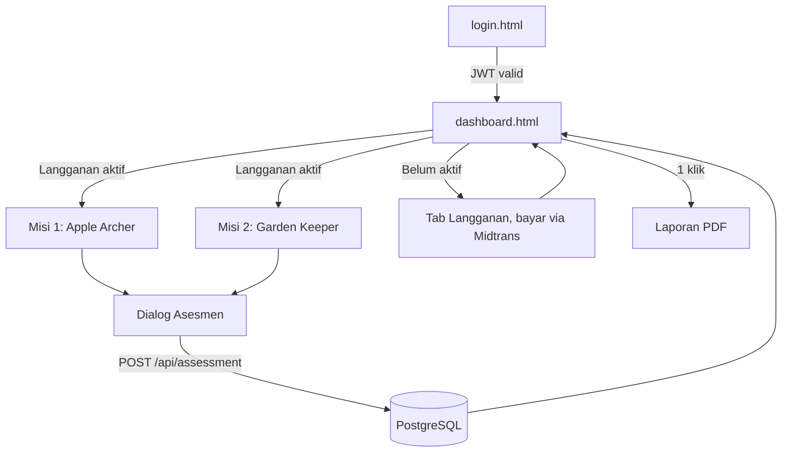
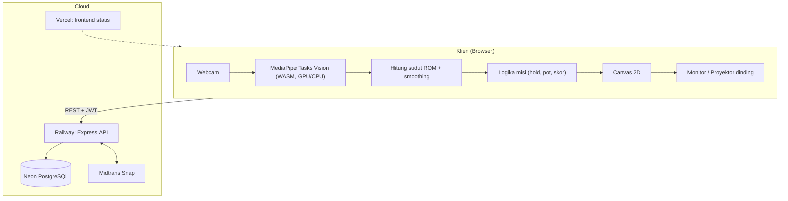
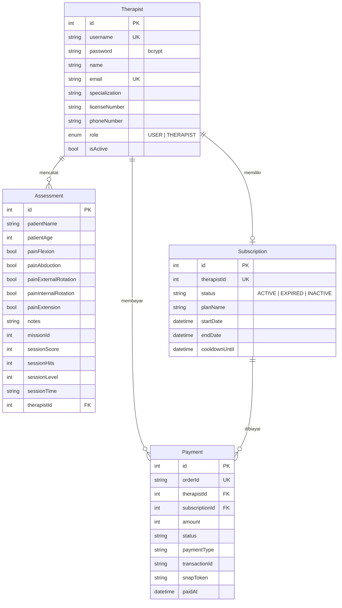

# Product Requirements Document (PRD)

# MoveWall AI — Platform Tele-Rehabilitasi Bahu Berbasis Gamifikasi dan Computer Vision

---

## 1. Informasi Dokumen

| Field | Detail |
|---|---|
| Nama Produk | MoveWall AI |
| Jenis Dokumen | PRD *as-built* (disusun dari kondisi sistem yang berjalan saat ini) |
| Versi Dokumen | 2.0 |
| Tanggal | 7 November 2026 |
| Status | Selaras dengan kode pada repositori `movewall` |
| Pengganti | `PRD_MoveWall_AI_v1.0.md` (versi aspiratif: Unity, laptop pasien, resep jarak jauh) |

### 1.1 Sumber Kebenaran

PRD ini diturunkan dari kode, bukan dari dokumen rencana. Bila dokumen lain berbeda, kode yang dianggap benar.

| Area | Sumber |
|---|---|
| Backend API | `game-ui/backend/server.js` |
| Skema data | `game-ui/backend/prisma/schema.prisma`, `prisma/seed.js` |
| Misi 1 | `game-ui/index.html`, `game-ui/app.js` |
| Misi 2 | `game-ui/mission2.html`, `game-ui/mission2.js` |
| Login dan Dashboard | `game-ui/login.html`, `game-ui/dashboard.html`, `game-ui/dashboard.js` |
| Deployment | `vercel.json`, `game-ui/vercel.json`, `game-ui/backend/railway.json` |
| Riset CV (Python) | `adaptive_engine.py`, `angle_calculator.py`, `edge_pipeline.py`, `landmark_filter.py`, `rep_state_machine.py` |
| Konteks produk | `MOVEWALL-AI.md`, `README.md`, `Task*.md`, `walkthrough.md` |

### 1.2 Perbedaan Dokumen Lain dengan Kode

| Topik | Dokumen lama (README, PRD v1.0) | Kode saat ini |
|---|---|---|
| Waktu tahan target Misi 1 | 3 detik | **2 detik** (`TARGET_HOLD_SECONDS = 2.0`) |
| Toleransi sudut Misi 1 | ±8° | **-6° / +7°** dari target |
| Pintasan keyboard `Space`, `R`, `N`, `Esc` | Ada | **Tidak ada** di game. Hanya `D` (debug, Misi 1), `Esc`/panah/`Enter` di combobox asesmen, dan `Ctrl/Cmd+K` di dashboard |
| Akses endpoint asesmen | Cukup JWT | **JWT dan langganan aktif** |
| Engine Python (FSM, adaptif, filter) | Bagian alur produk | **Tidak terhubung** ke aplikasi web. Hanya riset dan demo CLI |
| Platform | Unity/WebGL, ML Kit | **HTML, CSS, JS murni** dengan MediaPipe Tasks Vision |
| Resep ROM jarak jauh oleh terapis | Fitur inti | **Belum ada** |
| Tema desain | Terang atau gelap tidak spesifik | Dashboard punya toggle tema gelap/terang |

---

## 2. Ringkasan Produk

### 2.1 Masalah

Latihan rehabilitasi bahu cenderung membosankan, sulit diukur secara objektif, dan sulit dipantau fisioterapis. Solusi berbasis sensor kedalaman atau instalasi khusus mahal dan sulit diskalakan.

### 2.2 Solusi

MoveWall AI mengubah gerakan terapeutik bahu menjadi **misi permainan** yang dikendalikan gerakan tubuh. Kamera web biasa (2D RGB) menangkap pasien. Estimasi pose dan sudut sendi dihitung **di browser** dengan MediaPipe. Permainan dapat ditampilkan di monitor atau diproyeksikan ke dinding. Setelah sesi, terapis mengisi **asesmen** (nyeri per gerakan dan catatan), lalu memantau riwayat dan menerbitkan **laporan PDF** lewat dashboard. Akses fitur klinis dan permainan diatur oleh **langganan berbayar** per terapis (Midtrans).

> Prinsip dari `MOVEWALL-AI.md`: *game task = therapeutic movement yang dikemas dalam bentuk permainan.*

### 2.3 Diferensiasi

1. **Tanpa perangkat khusus.** Cukup webcam dan browser modern.
2. **Edge-first.** Pose dan sudut dihitung di klien. Video tidak dikirim ke server, hanya hasil sesi dan asesmen.
3. **Objektif.** ROM dihitung dari vektor landmark, bukan dari estimasi subjektif.
4. **Siklus tertutup.** Game → asesmen → dashboard → laporan PDF.

---

## 3. Tujuan dan Non-Tujuan

### 3.1 Tujuan (sudah diimplementasikan)

| ID | Tujuan |
|---|---|
| G1 | Menyediakan dua misi latihan bahu yang dapat dimainkan dengan webcam |
| G2 | Mencatat hasil sesi dan evaluasi nyeri per gerakan ROM ke database |
| G3 | Menyajikan KPI klinik, direktori pasien, riwayat sesi, dan tren skor |
| G4 | Mengekspor rekam medis pasien ke PDF A4 dalam satu klik |
| G5 | Memonetisasi lewat langganan 30 hari berbayar (Midtrans) dengan *paywall* |

### 3.2 Non-Tujuan (belum ada di sistem saat ini)

- Aplikasi mobile native dan permainan berbasis Unity.
- Akun, login, atau portal untuk **pasien** (enum `Role.USER` ada, tetapi belum dipakai di alur mana pun).
- Entitas pasien terpisah, resep latihan, jadwal, dan notifikasi.
- Perekaman atau pemutaran ulang video, serta deteksi gerakan kompensasi komprehensif.
- Misi 3 dan seterusnya (lihat 11. Roadmap).
- Sertifikasi regulasi (HIPAA, alat kesehatan) dan audit klinis.
- Penggunaan modul Python di produksi.

---

## 4. Pengguna dan Persona

| Peran | Deskripsi | Interaksi |
|---|---|---|
| **Terapis / Fisioterapis** (`Role.THERAPIST`) | Satu-satunya pengguna dengan akun. Login, memegang langganan, menjalankan sesi bersama pasien, mengisi asesmen, memantau dashboard. | Seluruh sistem |
| **Pasien** | Tidak punya akun. Memainkan misi dengan gerakan tubuh di depan kamera, biasanya didampingi terapis. Identitas hanya berupa nama dan usia pada form asesmen. | Game saja (tidak langsung) |
| **Admin sistem / developer** | Menyiapkan lingkungan, *seed* data, dan menjalankan deployment. | API `dev/seed`, konfigurasi cloud |

Konteks utama: sesi terpandu di klinik atau ruang latihan dengan monitor atau proyektor, terapis mendampingi dan menekan tombol **Stop** bila pasien merasa nyeri.

---

## 5. Cakupan Fungsional

### 5.1 Peta Halaman

| Halaman | File | Akses | Fungsi |
|---|---|---|---|
| Login | `login.html` | Publik | Autentikasi terapis, tombol isi otomatis kredensial demo |
| Dashboard | `dashboard.html` + `dashboard.js` | Perlu login | KPI, direktori pasien, detail pasien, PDF, langganan |
| Misi 1: Apple Archer | `index.html` + `app.js` | Perlu login + langganan aktif | Fleksi bahu |
| Misi 2: Garden Keeper | `mission2.html` + `mission2.js` | Perlu login + langganan aktif | Jangkauan bahu dan buka/tutup tangan |

Navigasi antarmisi dan dashboard ada di *mission switcher* (`M1`, `M2`, `📊 Admin`). Rute bersih (`/login`, `/dashboard`, `/mission2`) disediakan Vercel (`cleanUrls`).

### 5.2 Autentikasi dan Sesi (FR-AUTH)

| ID | Kebutuhan | Status |
|---|---|---|
| FR-AUTH-1 | Login dengan `username` dan `password`. Password diverifikasi dengan bcrypt. | Ada |
| FR-AUTH-2 | JWT berlaku 8 jam, memuat `id`, `username`, `name`, `role`. | Ada |
| FR-AUTH-3 | Akun dengan `isActive = false` ditolak (403). | Ada |
| FR-AUTH-4 | Token dan profil disimpan di `sessionStorage` (`mw_token`, `mw_therapist`). Halaman game dan dashboard mengarahkan ke login bila token tidak ada. | Ada |
| FR-AUTH-5 | Dashboard memverifikasi token lewat `GET /api/auth/me`. Token tidak valid → keluar otomatis. | Ada |
| FR-AUTH-6 | Registrasi terapis lewat API (`POST /api/auth/register`, bcrypt cost 12, cek username unik). Tidak ada UI pendaftaran. | API saja |
| FR-AUTH-7 | Logout membersihkan sesi dan kembali ke login. | Ada |

### 5.3 Misi 1 — Apple Archer (FR-M1)

**Tujuan terapeutik:** *shoulder flexion*/elevasi sagital, reaching, akurasi gerakan.

| ID | Kebutuhan | Nilai aktual |
|---|---|---|
| FR-M1-1 | Estimasi pose lewat MediaPipe Pose Landmarker (model lokal `assets/pose_landmarker.task`), delegasi GPU dengan *fallback* CPU, target 30 FPS inferensi. | Ada |
| FR-M1-2 | Sudut ROM = sudut antara vektor torso (bahu→pinggul) dan lengan (bahu→pergelangan), dengan koreksi *aspect ratio* kamera, di-*smoothing* adaptif. Lengan kiri dan kanan dievaluasi, dipilih yang berkeyakinan lebih baik. | Ada |
| FR-M1-3 | 10 target ROM berurutan: **30, 45, 60, 75, 90** (Level 1) lalu **105, 120, 135, 150, 165** (Level 2). Total 10 hit. | Ada |
| FR-M1-4 | Satu hit sah bila sudut berada di jendela target (**-6° sampai +7°**) selama **2,0 detik** akumulatif. Di luar jendela, penghitung turun 1,5× laju (peluruhan halus agar getaran kecil tidak mereset). | Ada |
| FR-M1-5 | Hit sah memicu anak panah ke target, apel jatuh ke keranjang, skor `100 + max(0, puncak − target) × 4 + level × 12`, dan jeda 0,45 detik. | Ada |
| FR-M1-6 | Batas waktu **90 detik**. Habis → modal *timeout* (ulangi level, ulang total, atau isi asesmen). | Ada |
| FR-M1-7 | Selesai 10 hit → modal *mission complete* (skor, hit, level, sisa waktu) dengan opsi asesmen, main ulang, dan lanjut ke Misi 2. | Ada |
| FR-M1-8 | Tombol **Stop** (nyeri): menghentikan permainan, menjeda musik, menampilkan "Rest and contact your therapist". | Ada |
| FR-M1-9 | Deteksi kompensasi sederhana: angkat bahu (*shoulder hike*) ditandai pada status pelacakan. | Ada |
| FR-M1-10 | Kontrol: Start Camera, Pause, Reset, tombol musik latar. Penanganan kegagalan: kamera tidak tersedia, pose hilang ("No full body detected"), model gagal dimuat. | Ada |
| FR-M1-11 | Mode debug (`D`) menampilkan landmark dan keyakinan. | Ada |

**FSM status gerak di klien:** `RESTING` → `ASCENDING` → `AIMING` → `PEAK_HOLD` → hit; `DESCENDING` bila melewati batas atas.

### 5.4 Misi 2 — Garden Keeper (FR-M2)

**Tujuan terapeutik:** *shoulder flexion*, reaching, kontrol motorik, fungsi buka/tutup tangan.

| ID | Kebutuhan | Nilai aktual |
|---|---|---|
| FR-M2-1 | Pose Landmarker dan **Hand Landmarker** (`assets/hand_landmarker.task`, *fallback* ke Google Cloud Storage). | Ada |
| FR-M2-2 | Pointer berupa **gembor** mengikuti telapak tangan (titik tengah pergelangan dan MCP jari tengah, cermin horizontal). | Ada |
| FR-M2-3 | Tangan **terbuka** (≥3 dari 5 jari terbuka) = menyiram. Tangan **mengepal** = hanya membidik. | Ada |
| FR-M2-4 | 12 pot tersusun pada busur setengah lingkaran. ROM yang dibutuhkan per pot: 65, 85, 100, 115, 128, 138, 142, 138, 128, 115, 95, 65 derajat (pola naik lalu turun). | Ada |
| FR-M2-5 | Penyiraman hanya jalan bila **ketiga** syarat terpenuhi: gembor dalam radius ±85 px dari pot, tangan terbuka, dan ROM klinis dalam **±12°** dari ROM pot. Pot terisi sekitar 1,1 detik penyiraman stabil. Umpan balik teks menyarankan "angkat lebih tinggi" atau "turunkan sedikit". | Ada |
| FR-M2-6 | **Level 1 (terstruktur):** 6 pot pertama berurutan. | Ada |
| FR-M2-7 | **Level 2 (mode acak):** satu target acak aktif pada satu waktu (*single target locking*), dipilih dari pot tersisa (diutamakan indeks ≥ 6). Pot non-target terkunci dan menyalakan buzzer serta pesan "Pot Terkunci". Target aktif ditandai *beacon* dan lencana `🎯 TARGET ACAK`. | Ada |
| FR-M2-8 | Transisi Level 1 → Level 2 otomatis setelah 6 pot, dengan banner dan fanfare. | Ada |
| FR-M2-9 | Skor per pot: `120 + max(0, sudut kamera − ROM pot) × 3 + level × 15`. | Ada |
| FR-M2-10 | Batas waktu **120 detik**, tombol Stop (nyeri), Pause, Reset, ulangi level, musik, dan efek suara (Web Audio). | Ada |
| FR-M2-11 | Menyelesaikan 12 pot memunculkan lencana **"Status Pemulihan: Sangat Sembuh"** ("Pasien Sangat Sembuh") pada modal. Catatan klinis disarankan terisi otomatis di form asesmen. | Ada |

> **Catatan kejelasan klinis:** label "Sangat Sembuh" adalah penanda keberhasilan permainan, bukan diagnosis. Keputusan klinis tetap pada terapis (lihat 10. Risiko).

### 5.5 Asesmen Pasca-Sesi (FR-ASM)

Dialog muncul dari modal selesai atau modal waktu habis, pada kedua misi.

| ID | Kebutuhan |
|---|---|
| FR-ASM-1 | Field **Nama pasien** (combobox dengan saran dari pasien yang sudah ada, atau daftarkan nama baru). Wajib. |
| FR-ASM-2 | Field **Usia** (1–120). Wajib. Terisi otomatis untuk pasien lama. |
| FR-ASM-3 | Lima *checkbox* nyeri per gerakan: fleksi, abduksi, rotasi eksternal, rotasi internal, ekstensi. |
| FR-ASM-4 | **Catatan terapis** opsional. |
| FR-ASM-5 | Data sesi ikut tersimpan: `missionId` (1 atau 2), `sessionScore`, `sessionHits`, `sessionLevel`, `sessionTime` (teks sisa waktu di HUD). |
| FR-ASM-6 | Dikirim ke `POST /api/assessment`. Bila 403 `requiresSubscription`, paywall game ditampilkan. Ada keadaan *loading*, galat, dan sukses. |
| FR-ASM-7 | Nama terapis yang login ditampilkan pada dialog. |

### 5.6 Dashboard Klinis (FR-DSH)

| ID | Kebutuhan |
|---|---|
| FR-DSH-1 | **KPI global** (per terapis): total pasien, total sesi (rincian Misi 1/Misi 2), rata-rata skor, rata-rata hit, prevalensi nyeri (%), sesi dengan nyeri dan bebas nyeri. |
| FR-DSH-2 | **Direktori pasien**: pencarian waktu nyata (`Ctrl/Cmd+K` untuk fokus), filter Semua / Keluhan Nyeri / Bebas Nyeri. |
| FR-DSH-3 | **Detail pasien**: profil (usia, jumlah sesi, sesi pertama dan terakhir, level, skor terakhir/rata-rata/maks), matriks nyeri 5 gerakan, progres skor, tabel riwayat sesi (nomor, tanggal, misi, level, hit, skor, waktu, chip nyeri atau "bebas nyeri", catatan). |
| FR-DSH-4 | **Grafik tren** skor per sesi (kanvas), responsif terhadap perubahan ukuran dan tema. |
| FR-DSH-5 | **Laporan PDF** A4 (`html2pdf.js`): ID `MW-xxxxxx`, identitas pasien dan terapis (nama, SIP, spesialisasi, kontak), ringkasan, evaluasi nyeri, rekam sesi, rekomendasi, blok tanda tangan. |
| FR-DSH-6 | **Rekomendasi otomatis** pada laporan dibentuk dari catatan terakhir, jumlah sesi, level, hit, skor, dan tingkat nyeri (teks templat, bukan AI). |
| FR-DSH-7 | **Tema** terang/gelap, tersimpan di `localStorage` (`mw-theme`). |
| FR-DSH-8 | **Tab Langganan** (lihat 5.7). Tab pasien terkunci (lencana "🔒 Terkunci") bila langganan tidak aktif, dengan spanduk dan CTA bayar. |
| FR-DSH-9 | Parameter URL `?view=subscription` / `?view=patients` memilih tab awal. |

**Pengenal pasien:** pasien dikenali dari **nama (tidak peka huruf besar/kecil)** dalam lingkup terapis yang sama. Tidak ada ID pasien.

### 5.7 Langganan dan Pembayaran (FR-SUB)

| ID | Kebutuhan |
|---|---|
| FR-SUB-1 | Paket tunggal **MoveWall AI Pro 30 Hari**, **Rp 300.000**, masa aktif 30 hari. |
| FR-SUB-2 | Status: `ACTIVE`, `EXPIRED`, `INACTIVE`. Kedaluwarsa dihitung dari `endDate`. |
| FR-SUB-3 | **Paywall server:** asesmen, daftar pasien, statistik, ringkasan, dan laporan mengembalikan 403 `requiresSubscription` bila langganan tidak aktif. |
| FR-SUB-4 | **Paywall klien:** halaman game memeriksa `/api/subscription/status`, mengunci tombol mulai, menghentikan kamera dan musik, serta menampilkan modal kunci dengan CTA ke dashboard. |
| FR-SUB-5 | **Cooldown 30 hari:** pembayaran baru ditolak selama cooldown (`cooldownUntil` = `endDate`), kecuali body `force: true`. |
| FR-SUB-6 | Pembayaran lewat **Midtrans Snap** (sandbox atau produksi sesuai `MIDTRANS_IS_PRODUCTION`). Order ID `MW-SUB-{therapistId}-{timestamp}`. Data `Payment` dicatat `PENDING`. |
| FR-SUB-7 | Aktivasi dari tiga jalur: **webhook** `POST /api/subscription/notification` (verifikasi SHA-512 signature), **sinkronisasi manual** `POST /api/subscription/sync/:orderId` (cek ke Core API Midtrans), dan **simulator sandbox** `POST /api/subscription/test-simulate-success/:orderId`. |
| FR-SUB-8 | Status pembayaran dipetakan: `capture` (fraud *accept*) dan `settlement` → `SETTLEMENT` (aktivasi), `challenge` → `CHALLENGE`, `cancel/deny/expire` → status huruf besar, lainnya tetap `PENDING`. |
| FR-SUB-9 | Dashboard menampilkan status, sisa hari, sisa cooldown, fasilitas paket, dan riwayat transaksi. |

---

## 6. Aturan Bisnis dan Perhitungan Utama

| Aturan | Rumus / Nilai |
|---|---|
| Pain (sesi) | `true` bila minimal satu dari 5 *checkbox* nyeri dicentang |
| Prevalensi nyeri | `sesi dengan nyeri / total sesi × 100`, dibulatkan |
| Rata-rata skor | `Σ skor / total sesi`, dibulatkan |
| Rata-rata hit | `Σ hit / total sesi`, 1 desimal |
| Pasien unik | Nama dipangkas dan diubah ke huruf kecil |
| Nama misi | `missionId` 1 = Apple Archer, selain itu = Garden Keeper |
| Target gerakan di PDF | Misi 1: *Shoulder Flexion & Elevation*, Misi 2: *Shoulder Abduction & Hand Reaching* |
| Langganan aktif | `status = ACTIVE` dan `now ≤ endDate` |
| Periode | 30 hari dari waktu *settlement*. Pembayaran ulang menimpa periode (bukan menambah) |

---

## 7. Arsitektur dan Teknologi

| Lapisan | Teknologi |
|---|---|
| Frontend | HTML5, CSS3 (token desain v1.1/v2.0), JavaScript ES6+ tanpa framework dan bundler. `@mediapipe/tasks-vision` (lokal dengan *fallback* CDN jsDelivr), `html2pdf.js` |
| Backend | Node.js ≥ 22.12, Express 4, `jsonwebtoken`, `bcryptjs`, `cors`, `dotenv` |
| Data | PostgreSQL (Neon), Prisma 7.10 dengan adaptor `pg` |
| Pembayaran | Midtrans Snap dan Core API |
| Hosting | Vercel (statis, `outputDirectory: game-ui`), Railway (Nixpacks, `npm start`, *restart on failure* maks 10x) |
| Riset | Python 3.10+, OpenCV, MediaPipe, NumPy (tidak dipakai produksi) |

**Konfigurasi backend (`.env.example`):** `DATABASE_URL`, `DIRECT_URL`, `JWT_SECRET`, `PORT`, `MIDTRANS_SERVER_KEY`, `MIDTRANS_CLIENT_KEY`, `MIDTRANS_IS_PRODUCTION`.

**URL backend di klien:** diprioritaskan `sessionStorage.mw_backend_url` → `window.MOVEWALL_BACKEND_URL` → bila `localhost` pakai `http://localhost:3001` (kecuali `mw_use_local_backend=false`) → selain itu Railway produksi.

**CORS:** mengizinkan `*.vercel.app`, `*.up.railway.app`, `localhost` dan `127.0.0.1` (semua port), serta permintaan tanpa *origin*.

### 7.1 Model Data

Tabel: `therapists`, `subscriptions`, `payments`, `assessments`. Migrasi: `init` dan `add_subscription_payment_tables`. Satu baris `Assessment` = satu sesi pasien pada satu misi.

### 7.2 Referensi API

| Metode | Endpoint | Auth | Paywall | Fungsi |
|:---:|---|:---:|:---:|---|
| GET | `/api/health` | – | – | Status layanan |
| POST | `/api/auth/login` | – | – | Login, kembalikan JWT |
| POST | `/api/auth/register` | – | – | Daftar terapis |
| GET | `/api/auth/me` | JWT | – | Profil terapis |
| POST | `/api/assessment` | JWT | ✔ | Simpan sesi dan asesmen |
| GET | `/api/assessments` | JWT | ✔ | Semua asesmen terapis |
| GET | `/api/assessment/:id` | JWT | ✔ | Satu asesmen (milik terapis) |
| GET | `/api/patients` | JWT | ✔ | Pasien unik dan agregat |
| GET | `/api/patients/:name/summary` | JWT | ✔ | Analitik dan riwayat pasien |
| GET | `/api/patients/:name/report` | JWT | ✔ | Payload laporan PDF |
| GET | `/api/dashboard/stats` | JWT | ✔ | KPI, statistik nyeri, 8 asesmen terbaru |
| GET | `/api/subscription/config` | – | – | Client key, URL Snap, harga, durasi |
| GET | `/api/subscription/status` | JWT | – | Status, sisa hari, cooldown |
| GET | `/api/subscription/history` | JWT | – | Riwayat pembayaran |
| POST | `/api/subscription/create-transaction` | JWT | – | Buat transaksi Snap |
| POST | `/api/subscription/sync/:orderId` | JWT | – | Sinkron status ke Midtrans |
| POST | `/api/subscription/notification` | Signature | – | Webhook Midtrans |
| POST | `/api/subscription/test-simulate-success/:orderId` | JWT | – | Simulasi sukses (dev/sandbox) |
| POST | `/api/dev/seed` | – | – | Isi data demo |

**Data demo (`seed.js`):** terapis `therapist01` (Dr. Rina Setiawati, Sp.KFR) dan `therapist02` (Budi Wicaksono, S.Ft., Ftr), kata sandi demo sama; 4 pasien contoh dengan 12 sesi.

---

## 8. Kebutuhan Non-Fungsional

| Kategori | Kebutuhan | Kondisi saat ini |
|---|---|---|
| Kinerja | Inferensi pose sekitar 30 FPS, render kanvas mengikuti `requestAnimationFrame` | Dipenuhi pada perangkat memadai. Kamera diminta resolusi ideal 480 px |
| Privasi | Video tidak meninggalkan perangkat | Dipenuhi. Hanya data sesi dan asesmen yang dikirim |
| Kompatibilitas | Browser modern dengan WebAssembly, WebGL/CPU, dan `getUserMedia` | Chrome dan Edge terbaru direkomendasikan |
| Ketersediaan | Model dan WASM tersedia dengan *fallback* | Model pose dan tangan di-*host* lokal. WASM dari `node_modules` atau jsDelivr |
| Aksesibilitas | Dialog memakai `role="dialog"` dan `aria-modal`, kontrol dapat difokus, dukungan keyboard pada combobox | Parsial. Belum ada audit WCAG formal |
| Lokalisasi | Antarmuka berbahasa Indonesia | Dipenuhi. Sebagian pesan game masih Inggris ("Mission active", "Stopped") |
| Keamanan | JWT, bcrypt, verifikasi signature webhook, data dibatasi per `therapistId` | Sebagian. Lihat 10. Risiko |
| Skalabilitas | Backend tanpa status (*stateless*), pool koneksi | Agregasi dihitung di memori aplikasi (belum di SQL) |

---

## 9. Metrik Keberhasilan

Belum ada instrumentasi analitik di aplikasi. Metrik berikut dapat dihitung langsung dari data yang sudah tersimpan.

| Metrik | Definisi | Sumber data |
|---|---|---|
| Terapis aktif berbayar | Jumlah `Subscription` berstatus aktif | `subscriptions` |
| Konversi pembayaran | `Payment SETTLEMENT / Payment dibuat` | `payments` |
| Sesi per terapis per bulan | Jumlah `Assessment` per terapis | `assessments` |
| Tingkat penyelesaian misi | Sesi dengan hit = target / seluruh sesi | `sessionHits` vs target (10 atau 12) |
| Tren skor per pasien | Skor sesi ke-N dibanding sesi pertama | `sessionScore`, `createdAt` |
| Prevalensi nyeri | Sesi dengan nyeri / seluruh sesi | kolom `pain*` |
| Pasien kembali | Pasien dengan ≥ 2 sesi | agregasi nama |
| Rasio pemakaian Misi 1 vs Misi 2 | Per `missionId` | `assessments` |

---

## 10. Risiko, Utang Teknis, dan Celah yang Diketahui

Poin berikut ditemukan saat membaca kode dan perlu keputusan sebelum penggunaan produksi sungguhan.

| # | Temuan | Dampak | Rekomendasi |
|---|---|---|---|
| R1 | `JWT_SECRET` punya nilai *fallback* tertanam di kode | Token dapat dipalsukan bila variabel tidak diatur | Wajibkan variabel lingkungan, gagal *start* bila kosong |
| R2 | `POST /api/dev/seed` terbuka tanpa autentikasi di produksi | Siapa pun dapat menambah data dan akun demo | Matikan di produksi atau lindungi |
| R3 | `POST /api/auth/register` terbuka | Pendaftaran akun terapis tanpa kendali | Batasi (undangan/admin) atau tambahkan verifikasi |
| R4 | `test-simulate-success` aktif tanpa pengecekan lingkungan | Pengguna dapat mengaktifkan langganan tanpa membayar | Batasi hanya ke `MIDTRANS_IS_PRODUCTION=false` atau hapus |
| R5 | `force: true` melewati cooldown pembayaran | Mengabaikan aturan bisnis | Batasi untuk sandbox |
| R6 | Kredensial demo ditampilkan di halaman login dan README | Akun demo diketahui publik | Hapus di produksi |
| R7 | Pasien diidentifikasi dari nama | Nama kembar bercampur, salah ketik memecah riwayat, tidak ada ID rekam medis | Tambah entitas `Patient` dengan ID |
| R8 | Data kesehatan (nama, usia, nyeri) tanpa persetujuan, kebijakan privasi, dan jejak audit | Risiko kepatuhan (UU PDP) | Tambah *consent*, kebijakan, enkripsi dan log akses |
| R9 | Token di `sessionStorage`, tidak ada *refresh token* atau pembatasan laju login | Sesi habis 8 jam, rawan *brute force* | Rate limiting, penyimpanan lebih aman |
| R10 | Dokumentasi tidak selaras dengan kode (lihat 1.2) | Salah ekspektasi tim dan pengguna | Perbarui README dan selaraskan pada satu sumber |
| R11 | Label "Sangat Sembuh" dan rekomendasi PDF dihasilkan dari templat | Dapat dibaca sebagai diagnosis | Beri penafian dan wajibkan tinjauan terapis |
| R12 | Akurasi ROM bergantung posisi kamera dan pencahayaan, tanpa kalibrasi dan validasi klinis | Pengukuran belum terbukti secara klinis | Protokol kalibrasi dan validasi |
| R13 | `/api/patients` dan statistik menarik seluruh asesmen lalu menghitung di memori | Lambat saat data besar | Pindah agregasi ke SQL dan paginasi |
| R14 | Berkas CSS ganda (`styles.css`, `styles_game_part.css`, `styles_new_part.css`) dan token ganda (v1.1/v2.0), serta berkas `.crswap` di `assets/` | Beban pemeliharaan | Rapikan |
| R15 | Modul Python tidak dipakai aplikasi web | Logika adaptif dan FSM ganda | Putuskan: port ke JS atau arsipkan |

---

## 11. Roadmap

| Prioritas | Item | Alasan |
|---|---|---|
| P0 | Tutup R1–R6 (rahasia, endpoint dev, registrasi, simulator) | Syarat peluncuran aman |
| P0 | Entitas `Patient` dan *consent* | Integritas rekam medis, kepatuhan |
| P1 | Misi 3 (rotasi/abduksi) dan Misi 4 *Clean the Window* (lintasan multidireksional), sesuai `MOVEWALL-AI.md` | Menutup 5 gerakan yang sudah dinilai nyerinya |
| P1 | Menyimpan ROM maksimum dan akurasi per sesi (kini hanya skor, hit, level, waktu) | Memenuhi parameter pemantauan di konsep produk (ROM, akurasi, kualitas gerak, progresi) |
| P1 | Kalibrasi kamera dan validasi klinis | R12 |
| P2 | Resep target ROM/level oleh terapis, penyesuaian adaptif (mengadopsi `adaptive_engine.py`) | Siklus tertutup sesungguhnya |
| P2 | Portal atau akun pasien (`Role.USER`) | Latihan mandiri |
| P2 | Pintasan keyboard Space/R/N/Esc di game | Selaras dengan dokumentasi, berguna untuk terapis |
| P3 | Notifikasi, jadwal, ekspor data, multi-bahasa | Skala dan kenyamanan |

---

## 12. Kriteria Penerimaan Ringkas

Dipakai untuk regresi pada sistem saat ini.

1. Login `therapist01` berhasil dan mengarah ke dashboard. Kredensial salah menghasilkan 401, akun nonaktif 403.
2. Tanpa langganan aktif: tab pasien terkunci, tombol mulai game terkunci, dan API klinis mengembalikan 403 `requiresSubscription`.
3. Setelah pembayaran sukses (webhook, sinkronisasi, atau simulator sandbox): langganan `ACTIVE` selama 30 hari, cooldown 30 hari berlaku, game dan dashboard terbuka.
4. Misi 1: target 30° ... 165° berurutan, setiap hit butuh 2,0 detik di jendela -6°/+7°, selesai 10 hit dalam 90 detik memunculkan modal selesai. Waktu habis memunculkan modal *timeout*. Tombol Stop menghentikan permainan.
5. Misi 2: penyiraman hanya terjadi bila tangan terbuka, gembor dekat pot, dan ROM dalam ±12°. Level 2 mengunci pot non-target. 12 pot selesai memunculkan "Sangat Sembuh". Batas 120 detik.
6. Dialog asesmen menolak nama kosong atau usia di luar 1–120, menyimpan lima status nyeri, catatan, skor, hit, level, dan waktu, lalu data tampil di dashboard.
7. Dashboard menampilkan KPI yang konsisten dengan data, pencarian dan filter pasien bekerja, grafik tren tergambar, dan PDF terunduh dengan ID `MW-xxxxxx`.
8. Asesmen satu terapis tidak terlihat oleh terapis lain.

---

## 13. Glosarium

| Istilah | Arti |
|---|---|
| ROM | *Range of Motion*, rentang gerak sendi dalam derajat |
| Fleksi bahu | Mengangkat lengan ke depan/atas (bidang sagital) |
| Abduksi bahu | Mengangkat lengan ke samping (bidang koronal) |
| Hit / repetisi | Satu target yang berhasil dipenuhi (ditahan atau disiram) |
| Paywall | Penguncian fitur sampai langganan aktif |
| Cooldown | Masa 30 hari saat pembayaran baru ditolak |
| MediaPipe | Pustaka Google untuk deteksi pose dan tangan di perangkat |
| Snap | Antarmuka pembayaran Midtrans |

