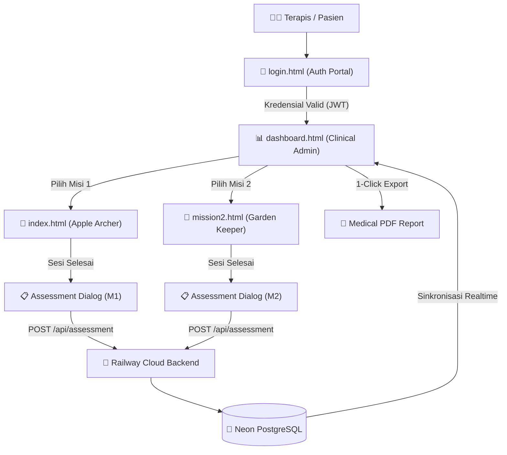

## Overview

Pelajari seluruh arsitektur frontend pada sistem **MoveWall AI** (`game-ui/`), lalu siapkan strategi dan konfigurasi deployment cloud ke **Vercel**. Pastikan seluruh aset statis, routing halaman, integrasi MediaPipe Computer Vision, dan koneksi ke backend Railway (`https://movewallai-production.up.railway.app`) terkonfigurasi secara optimal dan bebas dari kendala CORS/COEP.

---

## Analisis Arsitektur Frontend (`game-ui/`)

### 1. Struktur Berkas & Komponen Frontend
Sistem antarmuka MoveWall AI dibangun dengan arsitektur **Modern Vanilla Edge Web App** tanpa framework bundling yang berat, menjamin kecepatan rendering canvas 60 FPS dan latensi minimal:

| Berkas | Peran & Modul | Target Klinis / Fungsi |
|---|---|---|
| `login.html` | **Therapist Authentication Portal** | Form login glassmorphism, validasi JWT token terhadap Railway API, verifikasi peran dokter/fisioterapis. |
| `dashboard.html` & `dashboard.js` | **Clinical Admin & Reporting Portal** | Dashboard analitik KPI terapis, visualisasi toleransi nyeri ROM, riwayat sesi longitudinal pasien, serta generator ekspor rekam medis PDF standar rumah sakit (`html2pdf.js`). |
| `index.html` & `app.js` | **Misi 1: Apple Archer** | Latihan elevasi bahu sagital (Shoulder Flexion 30° s.d. 165°), inferensi pose MediaPipe BlazePose, animasi pemanah realistis, deteksi rep state machine, dan dialog asesmen klinis pasca-latihan. |
| `mission2.html` & `mission2.js` | **Misi 2: Garden Keeper** | Latihan jangkauan bahu (Shoulder Reaching & Hand Open/Close Tracking), MediaPipe Hand Landmarker, pointer gembor penyiram tanaman, Level 1 sekuensial, Level 2 tantangan acak dinamis, dan deteksi klinis "Sangat Sembuh". |
| `styles.css` | **Central Design System** | Token warna Dark Clinical Glassmorphism, animasi mikro, modal dialog, formulir asesmen, responsive breakpoints, dan print stylesheet A4 rekam medis. |
| `assets/` | **Static Visual Assets** | Background kebun apel realistis, logo klinik transparan, ilustrasi dan tekstur. |

### 2. Alur Pengguna & Routing Antar Halaman

### 3. Ketergantungan Eksternal & Kebijakan Header (Security & CDN)
- **Google Fonts**: Inter, Atkinson Hyperlegible Next, Newsreader.
- **MediaPipe Tasks Vision**: Dimuat via jsdelivr CDN (`@mediapipe/tasks-vision@1.0.1`) dan Google Cloud Storage model weights.
- **html2pdf.js**: Dimuat via cdnjs CDN untuk perakitan dokumen PDF rekam medis.
- **Railway Cloud Backend**: `https://movewallai-production.up.railway.app` (REST API & Auth).
- **Penyesuaian Kritis `vercel.json`**:
  - Menghapus header `Cross-Origin-Embedder-Policy: require-corp` yang sebelumnya berpotensi memblokir aset CDN eksternal (Google Fonts, jsdelivr, cdnjs).
  - Menetapkan header `Cross-Origin-Opener-Policy: same-origin-allow-popups` dan caching aset statis optimal.

---

## Rencana & Strategi Deployment ke Vercel

### Opsi A: Deployment Terotomasi via Vercel Git Integration (Recommended)
1. Hubungkan repositori GitHub `airlanggapradana/smart_climbing` (atau `movewall_ai`) ke project baru di Vercel.
2. Tetapkan **Root Directory** ke folder `game-ui` (atau manfaatkan root `vercel.json` dengan `outputDirectory: "game-ui"`).
3. Framework Preset: Pilih **Other** (Static HTML).
4. Build Command: Kosongkan (None) atau `npm run build`.
5. Output Directory: `.` (jika Root Directory di-set ke `game-ui`) atau `game-ui`.
6. Environment Variables (Opsional): `MOVEWALL_BACKEND_URL` diarahkan ke `https://movewallai-production.up.railway.app`.

### Opsi B: Deployment Langsung via Vercel CLI
1. Jalankan autentikasi `npx vercel login` jika menggunakan token/CLI.
2. Deploy langsung dari direktori `game-ui`: `npx vercel --prod`.

---

## Checklist Task Deployment

- [ ] **Audit & Refine Konfigurasi Vercel**:
  - Perbaiki `game-ui/vercel.json` agar bebas dari pemblokiran COEP `require-corp`.
  - Buat root `vercel.json` untuk mengamankan routing jika repositori di-build dari root.
- [ ] **Validasi Backend Origin**:
  - Pastikan seluruh file (`login.html`, `dashboard.js`, `app.js`, `mission2.js`) memiliki fallback default ke Railway production backend `https://movewallai-production.up.railway.app`.
- [ ] **Penyusunan Dokumentasi Walkthrough**:
  - Rangkum arsitektur frontend dan langkah deployment Vercel pada `walkthrough.md`.
- [ ] **Konfirmasi Pengguna**:
  - Tampilkan rencana dan arsitektur kepada pengguna sebelum eksekusi deployment live.
- [ ] **Eksekusi Deployment Vercel**:
  - Hubungkan dan deploy ke Vercel hingga mendapatkan domain publik aktif `https://*.vercel.app`.
- [ ] **Verifikasi Live di Browser**:
  - Uji halaman login, redirect dashboard, dan kedua misi rehabilitasi pada domain Vercel.
